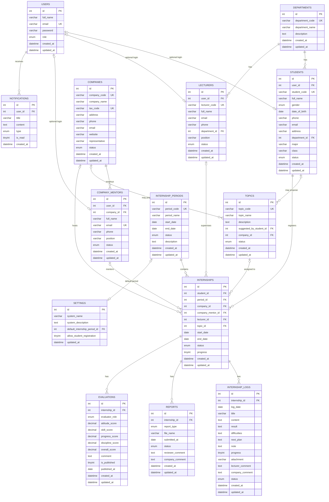

# DATABASE DESIGN DOCUMENT
## Hệ thống Quản lý Thực tập Tốt nghiệp — MySQL Schema (Phase Database Design)

> Tài liệu này được suy ra **trực tiếp** từ source code frontend hiện tại (`client/src/data/*.js`, `client/src/context/*.jsx`, `client/src/utils/*Status.js`), không thiết kế nghiệp vụ mới. Mọi field, enum, quan hệ đều đối chiếu với dữ liệu/logic thật đang chạy. Các điểm mock data có giới hạn hoặc chưa rõ ràng được liệt kê riêng ở Mục I, không tự đoán.

---

## A. Entity list

| # | Table | Purpose |
|---|-------|---------|
| 1 | `users` | Tài khoản đăng nhập & phân quyền (admin/student/lecturer/company_mentor) |
| 2 | `departments` | Khoa/Bộ môn quản lý Sinh viên và Giảng viên |
| 3 | `students` | Hồ sơ sinh viên |
| 4 | `lecturers` | Hồ sơ giảng viên |
| 5 | `companies` | Doanh nghiệp tiếp nhận thực tập |
| 6 | `company_mentors` | Người hướng dẫn tại doanh nghiệp |
| 7 | `internship_periods` | Đợt thực tập theo học kỳ |
| 8 | `topics` | Ngân hàng đề tài thực tập |
| 9 | `internships` | **Hồ sơ thực tập — bảng trung tâm** |
| 10 | `internship_logs` | Nhật ký thực tập hàng tuần |
| 11 | `reports` | Báo cáo thực tập (tuần / tổng kết) |
| 12 | `evaluations` | Đánh giá thực tập (Giảng viên & Doanh nghiệp) |
| 13 | `notifications` | Thông báo hệ thống gửi tới từng user |
| 14 | `settings` | Cấu hình hệ thống (bản ghi đơn — single row) |

Không có bảng nào bị trùng lặp source of truth: mỗi entity ở trên map 1-1 với đúng 1 Context/data file hiện tại (đã đối chiếu toàn bộ `data/*.js` và `context/*.jsx`).

---

## B. Chi tiết từng bảng

### 1. `users`
Purpose: tài khoản đăng nhập duy nhất của hệ thống (nguồn cho `AuthContext.login`).

| Column | Type | Null | Default | Key | Description |
|---|---|---|---|---|---|
| id | INT UNSIGNED | NOT NULL | AUTO_INCREMENT | PK | |
| full_name | VARCHAR(150) | NOT NULL | | | |
| email | VARCHAR(255) | NOT NULL | | UNIQUE | Định danh đăng nhập |
| password | VARCHAR(255) | NOT NULL | | | Mock đang lưu plaintext — backend **bắt buộc** hash bcrypt (mục I.6) |
| role | ENUM('admin','student','lecturer','company_mentor') | NOT NULL | | INDEX | Đúng 4 role hiện có, không thêm role mới |
| created_at | DATETIME | NOT NULL | CURRENT_TIMESTAMP | | |
| updated_at | DATETIME | NOT NULL | CURRENT_TIMESTAMP (ON UPDATE) | | |

### 2. `departments`
Purpose: Khoa/Bộ môn — quản lý theo Admin (`DepartmentsPage`).

| Column | Type | Null | Default | Key | Description |
|---|---|---|---|---|---|
| id | INT UNSIGNED | NOT NULL | AUTO_INCREMENT | PK | |
| department_code | VARCHAR(20) | NOT NULL | | UNIQUE | Validate unique ở FE (`isFieldTaken('department_code', ...)`) |
| department_name | VARCHAR(150) | NOT NULL | | | |
| description | TEXT | NULL | NULL | | **[Correction 2026-09-30]** Không có trong `data/departments.js` gốc, nhưng có thật trong `DepartmentFormModal.jsx` (textarea) và cột "Mô tả" ở `DepartmentsPage.jsx` — phát hiện khi đối chiếu UI/Form với schema, bổ sung theo đúng hành vi Frontend |
| created_at | DATETIME | NOT NULL | CURRENT_TIMESTAMP | | |
| updated_at | DATETIME | NOT NULL | CURRENT_TIMESTAMP (ON UPDATE) | | |

Mock hiện tại **không có** field `status` cho Department — không tự thêm.

### 3. `students`
Purpose: hồ sơ sinh viên (`data/students.js`).

| Column | Type | Null | Default | Key | Description |
|---|---|---|---|---|---|
| id | INT UNSIGNED | NOT NULL | AUTO_INCREMENT | PK | |
| user_id | INT UNSIGNED | NULL | NULL | FK→users.id, UNIQUE | Liên kết tài khoản đăng nhập, optional |
| student_code | VARCHAR(20) | NOT NULL | | UNIQUE | Validate unique ở FE |
| full_name | VARCHAR(150) | NOT NULL | | | |
| gender | ENUM('Nam','Nữ','Khác') | NOT NULL | | | **[Correction 2026-09-30]** Mock data gốc (`data/students.js`) chỉ có 2 giá trị, nhưng `StudentFormModal.jsx` cho chọn cả `'Khác'` — phát hiện khi đối chiếu UI/Form với schema, ENUM cập nhật thành 3 giá trị để khớp đúng lựa chọn thực tế của Frontend |
| date_of_birth | DATE | NULL | | | |
| phone | VARCHAR(15) | NULL | | | |
| email | VARCHAR(255) | NOT NULL | | INDEX | **Không** UNIQUE — FE hiện KHÔNG validate email trùng cho Student (mục I.1) |
| address | VARCHAR(255) | NULL | | | |
| department_id | INT UNSIGNED | NOT NULL | | FK→departments.id, INDEX | Mọi record mock đều có |
| major | VARCHAR(150) | NULL | | | |
| class | VARCHAR(50) | NULL | | | |
| status | ENUM('active','inactive') | NOT NULL | 'active' | | |
| created_at | DATETIME | NOT NULL | CURRENT_TIMESTAMP | | |
| updated_at | DATETIME | NOT NULL | CURRENT_TIMESTAMP (ON UPDATE) | | |

### 4. `lecturers`
Purpose: hồ sơ giảng viên (`data/lecturers.js`).

| Column | Type | Null | Default | Key | Description |
|---|---|---|---|---|---|
| id | INT UNSIGNED | NOT NULL | AUTO_INCREMENT | PK | |
| user_id | INT UNSIGNED | NULL | NULL | FK→users.id, UNIQUE | |
| lecturer_code | VARCHAR(20) | NOT NULL | | UNIQUE | Validate unique ở FE |
| full_name | VARCHAR(150) | NOT NULL | | | |
| email | VARCHAR(255) | NOT NULL | | INDEX | Không UNIQUE — cùng lý do như Student (mục I.1) |
| phone | VARCHAR(15) | NULL | | | |
| department_id | INT UNSIGNED | NOT NULL | | FK→departments.id, INDEX | |
| position | VARCHAR(150) | NULL | | | Học hàm/học vị, text tự do |
| status | ENUM('active','inactive') | NOT NULL | 'active' | | |
| created_at | DATETIME | NOT NULL | CURRENT_TIMESTAMP | | |
| updated_at | DATETIME | NOT NULL | CURRENT_TIMESTAMP (ON UPDATE) | | |

### 5. `companies`
Purpose: doanh nghiệp tiếp nhận thực tập (`data/companies.js`).

| Column | Type | Null | Default | Key | Description |
|---|---|---|---|---|---|
| id | INT UNSIGNED | NOT NULL | AUTO_INCREMENT | PK | |
| company_code | VARCHAR(20) | NOT NULL | | UNIQUE | Validate unique ở FE |
| company_name | VARCHAR(255) | NOT NULL | | | |
| tax_code | VARCHAR(20) | NOT NULL | | UNIQUE | Validate unique ở FE |
| address | VARCHAR(255) | NULL | | | |
| phone | VARCHAR(15) | NULL | | | |
| email | VARCHAR(255) | NULL | | | Không UNIQUE — FE không validate |
| website | VARCHAR(255) | NULL | | | |
| representative | VARCHAR(150) | NULL | | | Người đại diện pháp lý |
| status | ENUM('active','inactive') | NOT NULL | 'active' | | |
| created_at | DATETIME | NOT NULL | CURRENT_TIMESTAMP | | |
| updated_at | DATETIME | NOT NULL | CURRENT_TIMESTAMP (ON UPDATE) | | |

### 6. `company_mentors`
Purpose: người hướng dẫn tại doanh nghiệp (`data/companyMentors.js`, vừa hoàn thiện CRUD Admin).

| Column | Type | Null | Default | Key | Description |
|---|---|---|---|---|---|
| id | INT UNSIGNED | NOT NULL | AUTO_INCREMENT | PK | |
| user_id | INT UNSIGNED | NULL | NULL | FK→users.id, UNIQUE | |
| company_id | INT UNSIGNED | NOT NULL | | FK→companies.id, INDEX | Mentor luôn thuộc đúng 1 công ty |
| full_name | VARCHAR(150) | NOT NULL | | | |
| email | VARCHAR(255) | NOT NULL | | UNIQUE | Validate unique ở FE — không có field code nên email là định danh |
| phone | VARCHAR(15) | NULL | | | |
| position | VARCHAR(150) | NULL | | | Chức vụ |
| status | ENUM('active','inactive') | NOT NULL | 'active' | | |
| created_at | DATETIME | NOT NULL | CURRENT_TIMESTAMP | | |
| updated_at | DATETIME | NOT NULL | CURRENT_TIMESTAMP (ON UPDATE) | | |

### 7. `internship_periods`
Purpose: đợt thực tập theo học kỳ (`data/internshipPeriods.js`).

| Column | Type | Null | Default | Key | Description |
|---|---|---|---|---|---|
| id | INT UNSIGNED | NOT NULL | AUTO_INCREMENT | PK | |
| period_code | VARCHAR(20) | NOT NULL | | UNIQUE | |
| period_name | VARCHAR(150) | NOT NULL | | | |
| start_date | DATE | NOT NULL | | | |
| end_date | DATE | NOT NULL | | | |
| status | ENUM('upcoming','ongoing','closed') | NOT NULL | 'upcoming' | INDEX | Đúng 3 giá trị trong `PeriodFormModal` |
| description | TEXT | NULL | NULL | | **[Correction 2026-09-30]** Không có trong `data/internshipPeriods.js` gốc, nhưng có trong `PeriodFormModal.jsx` (textarea "Mô tả", field CRUD thật dù chưa hiển thị ở cột bảng `InternshipPeriodsPage.jsx`) — phát hiện khi đối chiếu Form với schema ở Phase 2C, bổ sung theo đúng hành vi Frontend (cùng pattern với `departments.description`) |
| created_at | DATETIME | NOT NULL | CURRENT_TIMESTAMP | | |
| updated_at | DATETIME | NOT NULL | CURRENT_TIMESTAMP (ON UPDATE) | | |

### 8. `topics`
Purpose: ngân hàng đề tài (`data/topics.js`).

| Column | Type | Null | Default | Key | Description |
|---|---|---|---|---|---|
| id | INT UNSIGNED | NOT NULL | AUTO_INCREMENT | PK | |
| topic_code | VARCHAR(20) | NOT NULL | | UNIQUE | |
| topic_name | VARCHAR(255) | NOT NULL | | | |
| description | TEXT | NULL | | | |
| suggested_by_student_id | INT UNSIGNED | NULL | NULL | FK→students.id, INDEX | Đề tài do SV đề xuất (nếu có) |
| company_id | INT UNSIGNED | NULL | NULL | FK→companies.id, INDEX | Đề tài do DN đề xuất (nếu có) |
| status | ENUM('proposed','approved','rejected') | NOT NULL | 'proposed' | INDEX | Đúng 3 giá trị trong `TopicFormModal` |
| created_at | DATETIME | NOT NULL | CURRENT_TIMESTAMP | | |
| updated_at | DATETIME | NOT NULL | CURRENT_TIMESTAMP (ON UPDATE) | | |

Mock hiện tại không ràng buộc "chỉ 1 trong 2 nguồn gốc được set" — không tự thêm CHECK (mục I.4).

### 9. `internships` — bảng trung tâm
Purpose: hồ sơ thực tập, liên kết Student/Company/CompanyMentor/Lecturer/Topic/Period (`data/internships.js`).

| Column | Type | Null | Default | Key | Description |
|---|---|---|---|---|---|
| id | INT UNSIGNED | NOT NULL | AUTO_INCREMENT | PK | |
| student_id | INT UNSIGNED | NOT NULL | | FK→students.id, INDEX | Luôn có ngay khi tạo (đăng ký) |
| period_id | INT UNSIGNED | NOT NULL | | FK→internship_periods.id, INDEX | Luôn có ngay khi tạo |
| company_id | INT UNSIGNED | NULL | NULL | FK→companies.id, INDEX | Phân công dần (progressive assignment) |
| company_mentor_id | INT UNSIGNED | NULL | NULL | FK→company_mentors.id, INDEX | Phân công dần, phải cùng `company_id` |
| lecturer_id | INT UNSIGNED | NULL | NULL | FK→lecturers.id, INDEX | Phân công dần |
| topic_id | INT UNSIGNED | NULL | NULL | FK→topics.id, INDEX | Đề xuất/duyệt dần |
| start_date | DATE | NULL | | | |
| end_date | DATE | NULL | | | |
| status | ENUM('pending','approved','in_progress','completed','rejected','cancelled') | NOT NULL | 'pending' | INDEX | Đúng `STATUS_META` trong `utils/internshipStatus.js`, lifecycle theo `ALLOWED_TRANSITIONS` |
| progress | TINYINT UNSIGNED | NOT NULL | 0 | CHECK 0–100 | Admin/GV nhập tay, **không** tự tính từ log (mục I.7) |
| created_at | DATETIME | NOT NULL | CURRENT_TIMESTAMP | | |
| updated_at | DATETIME | NOT NULL | CURRENT_TIMESTAMP (ON UPDATE) | | |

**UNIQUE(student_id, period_id)** — đúng ràng buộc `isDuplicateRegistration` hiện có ở `InternshipsContext` (1 SV chỉ có 1 hồ sơ / 1 đợt).

### 10. `internship_logs`
Purpose: nhật ký thực tập hàng tuần (`data/internshipLogs.js`).

| Column | Type | Null | Default | Key | Description |
|---|---|---|---|---|---|
| id | INT UNSIGNED | NOT NULL | AUTO_INCREMENT | PK | |
| internship_id | INT UNSIGNED | NOT NULL | | FK→internships.id, INDEX | |
| log_date | DATE | NOT NULL | | | |
| title | VARCHAR(255) | NOT NULL | | | |
| content | TEXT | NULL | | | |
| result | TEXT | NULL | | | |
| difficulties | TEXT | NULL | | | |
| next_plan | TEXT | NULL | | | |
| note | TEXT | NULL | | | |
| progress | TINYINT UNSIGNED | NULL | | CHECK 0–100 | Field progress riêng của log, độc lập với `internships.progress` |
| attachment | VARCHAR(255) | NULL | | | Mock luôn `null` — chưa có upload file thật |
| lecturer_comment | TEXT | NULL | | | Có giá trị → log bị khóa (không cho SV sửa/xóa) |
| company_comment | TEXT | NULL | | | |
| status | ENUM('submitted','reviewed') | NOT NULL | 'submitted' | INDEX | `reviewed` = khóa sửa/xóa phía Student (`StudentLogsPage` `isLocked`) |
| created_at | DATETIME | NOT NULL | CURRENT_TIMESTAMP | | |
| updated_at | DATETIME | NOT NULL | CURRENT_TIMESTAMP (ON UPDATE) | | |

Không tạo bảng "progress" riêng — đúng yêu cầu, dùng lại status + progress ngay trên bảng log.

### 11. `reports`
Purpose: báo cáo thực tập (`data/reports.js`).

| Column | Type | Null | Default | Key | Description |
|---|---|---|---|---|---|
| id | INT UNSIGNED | NOT NULL | AUTO_INCREMENT | PK | |
| internship_id | INT UNSIGNED | NOT NULL | | FK→internships.id, INDEX | |
| report_type | ENUM('weekly','final') | NOT NULL | | | Đúng `REPORT_TYPE_LABEL` |
| file_name | VARCHAR(255) | NOT NULL | | | Tên file minh họa — **chưa** có upload thật (đúng comment trong `ReportFormModal`) |
| submitted_at | DATE | NOT NULL | | | |
| status | ENUM('draft','submitted','approved','rejected') | NOT NULL | 'draft' | INDEX | Đúng `REPORT_STATUS_META` |
| reviewer_comment | TEXT | NULL | | | Nhận xét của Giảng viên |
| company_comment | TEXT | NULL | | | Nhận xét của Doanh nghiệp |
| created_at | DATETIME | NOT NULL | CURRENT_TIMESTAMP | | |
| updated_at | DATETIME | NOT NULL | CURRENT_TIMESTAMP (ON UPDATE) | | |

### 12. `evaluations`
Purpose: đánh giá thực tập từ Giảng viên & Doanh nghiệp (`data/evaluations.js`).

| Column | Type | Null | Default | Key | Description |
|---|---|---|---|---|---|
| id | INT UNSIGNED | NOT NULL | AUTO_INCREMENT | PK | |
| internship_id | INT UNSIGNED | NOT NULL | | FK→internships.id, INDEX | |
| evaluator_role | ENUM('lecturer','company') | NOT NULL | | INDEX | **Không** có `evaluator_id` — người đánh giá suy ra từ `internships.lecturer_id` / `internships.company_mentor_id` |
| attitude_score | DECIMAL(3,1) | NOT NULL | | CHECK 0–10 | |
| skill_score | DECIMAL(3,1) | NOT NULL | | CHECK 0–10 | |
| progress_score | DECIMAL(3,1) | NOT NULL | | CHECK 0–10 | |
| discipline_score | DECIMAL(3,1) | NOT NULL | | CHECK 0–10 | |
| overall_score | DECIMAL(3,1) | NOT NULL | | CHECK 0–10 | |
| comment | TEXT | NULL | | | |
| is_published | TINYINT(1) | NOT NULL | 0 | | SV chỉ thấy khi = 1 |
| published_at | DATE | NULL | NULL | | |
| created_at | DATETIME | NOT NULL | CURRENT_TIMESTAMP | | |
| updated_at | DATETIME | NOT NULL | CURRENT_TIMESTAMP (ON UPDATE) | | |

**UNIQUE(internship_id, evaluator_role)** — đúng logic `.find(e => e.internship_id === X && e.evaluator_role === 'lecturer'/'company')` dùng khắp nơi trong FE (tối đa 1 đánh giá GV + 1 đánh giá DN / hồ sơ).

### 13. `notifications`
Purpose: thông báo hệ thống (`data/notifications.js`).

| Column | Type | Null | Default | Key | Description |
|---|---|---|---|---|---|
| id | INT UNSIGNED | NOT NULL | AUTO_INCREMENT | PK | |
| user_id | INT UNSIGNED | NOT NULL | | FK→users.id, INDEX | |
| title | VARCHAR(255) | NOT NULL | | | |
| content | TEXT | NULL | | | |
| type | ENUM('internship','assignment','report','reminder','evaluation','log') | NOT NULL | | INDEX | 5 giá trị có nhãn hiển thị (`TYPE_LABEL`) + `log` xuất hiện trong mock nhưng chưa có nhãn (mục I.3) |
| is_read | TINYINT(1) | NOT NULL | 0 | INDEX | |
| created_at | DATETIME | NOT NULL | CURRENT_TIMESTAMP | | |

Không có `updated_at` — thông báo không có khái niệm "sửa nội dung", chỉ toggle `is_read`. Đây vẫn là dữ liệu tĩnh/seed, chưa có event engine sinh thông báo tự động (giữ nguyên như hiện tại, không tự thêm cơ chế).

### 14. `settings` — bản ghi cấu hình đơn (singleton)
Purpose: cấu hình hệ thống, KHÔNG phải danh sách CRUD (`SettingsContext.jsx`).

| Column | Type | Null | Default | Key | Description |
|---|---|---|---|---|---|
| id | TINYINT UNSIGNED | NOT NULL | 1 | PK, CHECK (id = 1) | Ép luôn chỉ có đúng 1 dòng |
| system_name | VARCHAR(255) | NOT NULL | | | |
| system_description | TEXT | NULL | | | |
| default_internship_period_id | INT UNSIGNED | NULL | NULL | FK→internship_periods.id | |
| allow_student_registration | TINYINT(1) | NOT NULL | 1 | | Gate nút "Đăng ký thực tập" |
| updated_at | DATETIME | NOT NULL | CURRENT_TIMESTAMP (ON UPDATE) | | |

`FRONTEND_VERSION` (`'1.0.0'`) là hằng số hiển thị trong code FE, **không** lưu DB (đúng yêu cầu mục 10 — display-only).

---

## C. Relationships

```
departments      1 : N   students
departments      1 : N   lecturers
companies        1 : N   company_mentors
companies        1 : 0..N topics            (topics.company_id optional)
students         1 : 0..N topics            (topics.suggested_by_student_id optional)
users            1 : 0..1 students           (students.user_id optional, unique)
users            1 : 0..1 lecturers          (lecturers.user_id optional, unique)
users            1 : 0..1 company_mentors    (company_mentors.user_id optional, unique)
users            1 : N   notifications
students         1 : N   internships
internship_periods 1 : N internships
companies        1 : 0..N internships        (company_id optional — progressive assignment)
company_mentors  1 : 0..N internships        (company_mentor_id optional)
lecturers        1 : 0..N internships        (lecturer_id optional)
topics           1 : 0..N internships        (topic_id optional)
internships      1 : N   internship_logs
internships      1 : N   reports
internships      1 : N   evaluations         (thực tế tối đa 2: 1 lecturer + 1 company, ép bằng UNIQUE)
internship_periods 1 : 0..1 settings         (default_internship_period_id, chỉ 1 dòng settings tồn tại)
```

Không có quan hệ N:N nào trong toàn hệ thống hiện tại — mọi liên kết đều là FK 1:N hoặc 1:0..1, khớp đúng với cách Context hiện tại lưu trữ (mỗi record chỉ giữ FK dạng số ít, không có mảng id).

---

## D. ERD (Mermaid)



---

## E. SQL Schema (đầy đủ)

```sql
CREATE DATABASE IF NOT EXISTS internship_management
  CHARACTER SET utf8mb4
  COLLATE utf8mb4_unicode_ci;

USE internship_management;

-- 1. USERS
CREATE TABLE users (
  id INT UNSIGNED AUTO_INCREMENT PRIMARY KEY,
  full_name VARCHAR(150) NOT NULL,
  email VARCHAR(255) NOT NULL,
  password VARCHAR(255) NOT NULL,
  role ENUM('admin','student','lecturer','company_mentor') NOT NULL,
  created_at DATETIME NOT NULL DEFAULT CURRENT_TIMESTAMP,
  updated_at DATETIME NOT NULL DEFAULT CURRENT_TIMESTAMP ON UPDATE CURRENT_TIMESTAMP,
  UNIQUE KEY uk_users_email (email),
  INDEX idx_users_role (role)
) ENGINE=InnoDB;

-- 2. DEPARTMENTS
CREATE TABLE departments (
  id INT UNSIGNED AUTO_INCREMENT PRIMARY KEY,
  department_code VARCHAR(20) NOT NULL,
  department_name VARCHAR(150) NOT NULL,
  description TEXT NULL,
  created_at DATETIME NOT NULL DEFAULT CURRENT_TIMESTAMP,
  updated_at DATETIME NOT NULL DEFAULT CURRENT_TIMESTAMP ON UPDATE CURRENT_TIMESTAMP,
  UNIQUE KEY uk_departments_code (department_code)
) ENGINE=InnoDB;

-- 3. STUDENTS
CREATE TABLE students (
  id INT UNSIGNED AUTO_INCREMENT PRIMARY KEY,
  user_id INT UNSIGNED NULL,
  student_code VARCHAR(20) NOT NULL,
  full_name VARCHAR(150) NOT NULL,
  gender ENUM('Nam','Nữ','Khác') NOT NULL,
  date_of_birth DATE NULL,
  phone VARCHAR(15) NULL,
  email VARCHAR(255) NOT NULL,
  address VARCHAR(255) NULL,
  department_id INT UNSIGNED NOT NULL,
  major VARCHAR(150) NULL,
  class VARCHAR(50) NULL,
  status ENUM('active','inactive') NOT NULL DEFAULT 'active',
  created_at DATETIME NOT NULL DEFAULT CURRENT_TIMESTAMP,
  updated_at DATETIME NOT NULL DEFAULT CURRENT_TIMESTAMP ON UPDATE CURRENT_TIMESTAMP,
  UNIQUE KEY uk_students_code (student_code),
  UNIQUE KEY uk_students_user (user_id),
  INDEX idx_students_department (department_id),
  INDEX idx_students_status (status),
  CONSTRAINT fk_students_user FOREIGN KEY (user_id) REFERENCES users(id)
    ON DELETE SET NULL ON UPDATE CASCADE,
  CONSTRAINT fk_students_department FOREIGN KEY (department_id) REFERENCES departments(id)
    ON DELETE RESTRICT ON UPDATE CASCADE
) ENGINE=InnoDB;

-- 4. LECTURERS
CREATE TABLE lecturers (
  id INT UNSIGNED AUTO_INCREMENT PRIMARY KEY,
  user_id INT UNSIGNED NULL,
  lecturer_code VARCHAR(20) NOT NULL,
  full_name VARCHAR(150) NOT NULL,
  email VARCHAR(255) NOT NULL,
  phone VARCHAR(15) NULL,
  department_id INT UNSIGNED NOT NULL,
  position VARCHAR(150) NULL,
  status ENUM('active','inactive') NOT NULL DEFAULT 'active',
  created_at DATETIME NOT NULL DEFAULT CURRENT_TIMESTAMP,
  updated_at DATETIME NOT NULL DEFAULT CURRENT_TIMESTAMP ON UPDATE CURRENT_TIMESTAMP,
  UNIQUE KEY uk_lecturers_code (lecturer_code),
  UNIQUE KEY uk_lecturers_user (user_id),
  INDEX idx_lecturers_department (department_id),
  INDEX idx_lecturers_status (status),
  CONSTRAINT fk_lecturers_user FOREIGN KEY (user_id) REFERENCES users(id)
    ON DELETE SET NULL ON UPDATE CASCADE,
  CONSTRAINT fk_lecturers_department FOREIGN KEY (department_id) REFERENCES departments(id)
    ON DELETE RESTRICT ON UPDATE CASCADE
) ENGINE=InnoDB;

-- 5. COMPANIES
CREATE TABLE companies (
  id INT UNSIGNED AUTO_INCREMENT PRIMARY KEY,
  company_code VARCHAR(20) NOT NULL,
  company_name VARCHAR(255) NOT NULL,
  tax_code VARCHAR(20) NOT NULL,
  address VARCHAR(255) NULL,
  phone VARCHAR(15) NULL,
  email VARCHAR(255) NULL,
  website VARCHAR(255) NULL,
  representative VARCHAR(150) NULL,
  status ENUM('active','inactive') NOT NULL DEFAULT 'active',
  created_at DATETIME NOT NULL DEFAULT CURRENT_TIMESTAMP,
  updated_at DATETIME NOT NULL DEFAULT CURRENT_TIMESTAMP ON UPDATE CURRENT_TIMESTAMP,
  UNIQUE KEY uk_companies_code (company_code),
  UNIQUE KEY uk_companies_tax_code (tax_code),
  INDEX idx_companies_status (status)
) ENGINE=InnoDB;

-- 6. COMPANY_MENTORS
CREATE TABLE company_mentors (
  id INT UNSIGNED AUTO_INCREMENT PRIMARY KEY,
  user_id INT UNSIGNED NULL,
  company_id INT UNSIGNED NOT NULL,
  full_name VARCHAR(150) NOT NULL,
  email VARCHAR(255) NOT NULL,
  phone VARCHAR(15) NULL,
  position VARCHAR(150) NULL,
  status ENUM('active','inactive') NOT NULL DEFAULT 'active',
  created_at DATETIME NOT NULL DEFAULT CURRENT_TIMESTAMP,
  updated_at DATETIME NOT NULL DEFAULT CURRENT_TIMESTAMP ON UPDATE CURRENT_TIMESTAMP,
  UNIQUE KEY uk_company_mentors_email (email),
  UNIQUE KEY uk_company_mentors_user (user_id),
  INDEX idx_company_mentors_company (company_id),
  INDEX idx_company_mentors_status (status),
  CONSTRAINT fk_company_mentors_user FOREIGN KEY (user_id) REFERENCES users(id)
    ON DELETE SET NULL ON UPDATE CASCADE,
  CONSTRAINT fk_company_mentors_company FOREIGN KEY (company_id) REFERENCES companies(id)
    ON DELETE RESTRICT ON UPDATE CASCADE
) ENGINE=InnoDB;

-- 7. INTERNSHIP_PERIODS
CREATE TABLE internship_periods (
  id INT UNSIGNED AUTO_INCREMENT PRIMARY KEY,
  period_code VARCHAR(20) NOT NULL,
  period_name VARCHAR(150) NOT NULL,
  start_date DATE NOT NULL,
  end_date DATE NOT NULL,
  status ENUM('upcoming','ongoing','closed') NOT NULL DEFAULT 'upcoming',
  description TEXT NULL,
  created_at DATETIME NOT NULL DEFAULT CURRENT_TIMESTAMP,
  updated_at DATETIME NOT NULL DEFAULT CURRENT_TIMESTAMP ON UPDATE CURRENT_TIMESTAMP,
  UNIQUE KEY uk_periods_code (period_code),
  INDEX idx_periods_status (status)
) ENGINE=InnoDB;

-- 8. TOPICS
CREATE TABLE topics (
  id INT UNSIGNED AUTO_INCREMENT PRIMARY KEY,
  topic_code VARCHAR(20) NOT NULL,
  topic_name VARCHAR(255) NOT NULL,
  description TEXT NULL,
  suggested_by_student_id INT UNSIGNED NULL,
  company_id INT UNSIGNED NULL,
  status ENUM('proposed','approved','rejected') NOT NULL DEFAULT 'proposed',
  created_at DATETIME NOT NULL DEFAULT CURRENT_TIMESTAMP,
  updated_at DATETIME NOT NULL DEFAULT CURRENT_TIMESTAMP ON UPDATE CURRENT_TIMESTAMP,
  UNIQUE KEY uk_topics_code (topic_code),
  INDEX idx_topics_student (suggested_by_student_id),
  INDEX idx_topics_company (company_id),
  INDEX idx_topics_status (status),
  CONSTRAINT fk_topics_student FOREIGN KEY (suggested_by_student_id) REFERENCES students(id)
    ON DELETE SET NULL ON UPDATE CASCADE,
  CONSTRAINT fk_topics_company FOREIGN KEY (company_id) REFERENCES companies(id)
    ON DELETE SET NULL ON UPDATE CASCADE
) ENGINE=InnoDB;

-- 9. INTERNSHIPS (bảng trung tâm)
CREATE TABLE internships (
  id INT UNSIGNED AUTO_INCREMENT PRIMARY KEY,
  student_id INT UNSIGNED NOT NULL,
  period_id INT UNSIGNED NOT NULL,
  company_id INT UNSIGNED NULL,
  company_mentor_id INT UNSIGNED NULL,
  lecturer_id INT UNSIGNED NULL,
  topic_id INT UNSIGNED NULL,
  start_date DATE NULL,
  end_date DATE NULL,
  status ENUM('pending','approved','in_progress','completed','rejected','cancelled') NOT NULL DEFAULT 'pending',
  progress TINYINT UNSIGNED NOT NULL DEFAULT 0,
  created_at DATETIME NOT NULL DEFAULT CURRENT_TIMESTAMP,
  updated_at DATETIME NOT NULL DEFAULT CURRENT_TIMESTAMP ON UPDATE CURRENT_TIMESTAMP,
  UNIQUE KEY uk_internships_student_period (student_id, period_id),
  INDEX idx_internships_period (period_id),
  INDEX idx_internships_company (company_id),
  INDEX idx_internships_mentor (company_mentor_id),
  INDEX idx_internships_lecturer (lecturer_id),
  INDEX idx_internships_topic (topic_id),
  INDEX idx_internships_status (status),
  CONSTRAINT chk_internships_progress CHECK (progress BETWEEN 0 AND 100),
  CONSTRAINT fk_internships_student FOREIGN KEY (student_id) REFERENCES students(id)
    ON DELETE RESTRICT ON UPDATE CASCADE,
  CONSTRAINT fk_internships_period FOREIGN KEY (period_id) REFERENCES internship_periods(id)
    ON DELETE RESTRICT ON UPDATE CASCADE,
  CONSTRAINT fk_internships_company FOREIGN KEY (company_id) REFERENCES companies(id)
    ON DELETE RESTRICT ON UPDATE CASCADE,
  CONSTRAINT fk_internships_mentor FOREIGN KEY (company_mentor_id) REFERENCES company_mentors(id)
    ON DELETE RESTRICT ON UPDATE CASCADE,
  CONSTRAINT fk_internships_lecturer FOREIGN KEY (lecturer_id) REFERENCES lecturers(id)
    ON DELETE RESTRICT ON UPDATE CASCADE,
  CONSTRAINT fk_internships_topic FOREIGN KEY (topic_id) REFERENCES topics(id)
    ON DELETE RESTRICT ON UPDATE CASCADE
) ENGINE=InnoDB;

-- 10. INTERNSHIP_LOGS
CREATE TABLE internship_logs (
  id INT UNSIGNED AUTO_INCREMENT PRIMARY KEY,
  internship_id INT UNSIGNED NOT NULL,
  log_date DATE NOT NULL,
  title VARCHAR(255) NOT NULL,
  content TEXT NULL,
  result TEXT NULL,
  difficulties TEXT NULL,
  next_plan TEXT NULL,
  note TEXT NULL,
  progress TINYINT UNSIGNED NULL,
  attachment VARCHAR(255) NULL,
  lecturer_comment TEXT NULL,
  company_comment TEXT NULL,
  status ENUM('submitted','reviewed') NOT NULL DEFAULT 'submitted',
  created_at DATETIME NOT NULL DEFAULT CURRENT_TIMESTAMP,
  updated_at DATETIME NOT NULL DEFAULT CURRENT_TIMESTAMP ON UPDATE CURRENT_TIMESTAMP,
  INDEX idx_logs_internship (internship_id),
  INDEX idx_logs_status (status),
  CONSTRAINT chk_logs_progress CHECK (progress IS NULL OR progress BETWEEN 0 AND 100),
  CONSTRAINT fk_logs_internship FOREIGN KEY (internship_id) REFERENCES internships(id)
    ON DELETE CASCADE ON UPDATE CASCADE
) ENGINE=InnoDB;

-- 11. REPORTS
CREATE TABLE reports (
  id INT UNSIGNED AUTO_INCREMENT PRIMARY KEY,
  internship_id INT UNSIGNED NOT NULL,
  report_type ENUM('weekly','final') NOT NULL,
  file_name VARCHAR(255) NOT NULL,
  submitted_at DATE NOT NULL,
  status ENUM('draft','submitted','approved','rejected') NOT NULL DEFAULT 'draft',
  reviewer_comment TEXT NULL,
  company_comment TEXT NULL,
  created_at DATETIME NOT NULL DEFAULT CURRENT_TIMESTAMP,
  updated_at DATETIME NOT NULL DEFAULT CURRENT_TIMESTAMP ON UPDATE CURRENT_TIMESTAMP,
  INDEX idx_reports_internship (internship_id),
  INDEX idx_reports_status (status),
  CONSTRAINT fk_reports_internship FOREIGN KEY (internship_id) REFERENCES internships(id)
    ON DELETE CASCADE ON UPDATE CASCADE
) ENGINE=InnoDB;

-- 12. EVALUATIONS
CREATE TABLE evaluations (
  id INT UNSIGNED AUTO_INCREMENT PRIMARY KEY,
  internship_id INT UNSIGNED NOT NULL,
  evaluator_role ENUM('lecturer','company') NOT NULL,
  attitude_score DECIMAL(3,1) NOT NULL,
  skill_score DECIMAL(3,1) NOT NULL,
  progress_score DECIMAL(3,1) NOT NULL,
  discipline_score DECIMAL(3,1) NOT NULL,
  overall_score DECIMAL(3,1) NOT NULL,
  comment TEXT NULL,
  is_published TINYINT(1) NOT NULL DEFAULT 0,
  published_at DATE NULL,
  created_at DATETIME NOT NULL DEFAULT CURRENT_TIMESTAMP,
  updated_at DATETIME NOT NULL DEFAULT CURRENT_TIMESTAMP ON UPDATE CURRENT_TIMESTAMP,
  UNIQUE KEY uk_evaluations_internship_role (internship_id, evaluator_role),
  INDEX idx_evaluations_published (is_published),
  CONSTRAINT chk_eval_attitude CHECK (attitude_score BETWEEN 0 AND 10),
  CONSTRAINT chk_eval_skill CHECK (skill_score BETWEEN 0 AND 10),
  CONSTRAINT chk_eval_progress CHECK (progress_score BETWEEN 0 AND 10),
  CONSTRAINT chk_eval_discipline CHECK (discipline_score BETWEEN 0 AND 10),
  CONSTRAINT chk_eval_overall CHECK (overall_score BETWEEN 0 AND 10),
  CONSTRAINT fk_evaluations_internship FOREIGN KEY (internship_id) REFERENCES internships(id)
    ON DELETE CASCADE ON UPDATE CASCADE
) ENGINE=InnoDB;

-- 13. NOTIFICATIONS
CREATE TABLE notifications (
  id INT UNSIGNED AUTO_INCREMENT PRIMARY KEY,
  user_id INT UNSIGNED NOT NULL,
  title VARCHAR(255) NOT NULL,
  content TEXT NULL,
  type ENUM('internship','assignment','report','reminder','evaluation','log') NOT NULL,
  is_read TINYINT(1) NOT NULL DEFAULT 0,
  created_at DATETIME NOT NULL DEFAULT CURRENT_TIMESTAMP,
  INDEX idx_notifications_user (user_id),
  INDEX idx_notifications_read (is_read),
  CONSTRAINT fk_notifications_user FOREIGN KEY (user_id) REFERENCES users(id)
    ON DELETE CASCADE ON UPDATE CASCADE
) ENGINE=InnoDB;

-- 14. SETTINGS (single row)
CREATE TABLE settings (
  id TINYINT UNSIGNED NOT NULL DEFAULT 1,
  system_name VARCHAR(255) NOT NULL,
  system_description TEXT NULL,
  default_internship_period_id INT UNSIGNED NULL,
  allow_student_registration TINYINT(1) NOT NULL DEFAULT 1,
  updated_at DATETIME NOT NULL DEFAULT CURRENT_TIMESTAMP ON UPDATE CURRENT_TIMESTAMP,
  PRIMARY KEY (id),
  CONSTRAINT chk_settings_singleton CHECK (id = 1),
  CONSTRAINT fk_settings_default_period FOREIGN KEY (default_internship_period_id) REFERENCES internship_periods(id)
    ON DELETE SET NULL ON UPDATE CASCADE
) ENGINE=InnoDB;

INSERT INTO settings (id, system_name, system_description, default_internship_period_id, allow_student_registration)
VALUES (1, 'Hệ thống quản lý thực tập tốt nghiệp',
  'Hệ thống hỗ trợ quản lý quy trình thực tập giữa sinh viên, giảng viên, doanh nghiệp và khoa.',
  NULL, 1);
```

### Giải thích lựa chọn ON DELETE (mục 11 yêu cầu)

| FK | ON DELETE | Lý do |
|---|---|---|
| `students.user_id` → users | SET NULL | Xóa tài khoản đăng nhập không được phép xóa hồ sơ sinh viên — chỉ mất liên kết, đúng nguyên tắc "không cascade-delete profile khi tài khoản mất" đã áp dụng cho Company Mentor. |
| `lecturers.user_id` → users | SET NULL | Tương tự. |
| `company_mentors.user_id` → users | SET NULL | Tương tự — đúng quyết định vừa triển khai ở `CompanyMentorsPage.handleDelete`. |
| `students.department_id` → departments | RESTRICT | Không cho xóa Khoa còn Sinh viên thuộc về — tránh orphan (đúng mục 11 chỉ ra). |
| `lecturers.department_id` → departments | RESTRICT | Tương tự cho Giảng viên. |
| `company_mentors.company_id` → companies | RESTRICT | Không cho xóa Doanh nghiệp còn người hướng dẫn thuộc về. |
| `topics.suggested_by_student_id` → students | SET NULL | Đây chỉ là **nguồn gốc** đề xuất, không phải phân công đang hoạt động — Topic vẫn có giá trị dùng lại dù người đề xuất bị xóa. |
| `topics.company_id` → companies | SET NULL | Tương tự — chỉ là nguồn gốc, không phải hồ sơ đang vận hành. |
| `internships.student_id` → students | RESTRICT | Hồ sơ thực tập là lịch sử — không được phép xóa Sinh viên khi còn hồ sơ (kể cả đã hoàn thành). |
| `internships.period_id` → internship_periods | RESTRICT | Không xóa Đợt đang có hồ sơ dùng — mất mốc thời gian toàn hệ thống. |
| `internships.company_id` → companies | RESTRICT | **Không CASCADE** (đúng cảnh báo mục 11: xóa Company không được kéo theo xóa Internship). Đổi/gỡ Company khỏi 1 hồ sơ là thao tác UPDATE qua `AssignCompanyModal` (chọn "Bỏ phân công"), không phải hệ quả của việc xóa Company. |
| `internships.company_mentor_id` → company_mentors | RESTRICT | Đúng y hệt rule vừa code trong `CompanyMentorsPage.handleDelete`: chặn xóa mentor đang được phân công. RESTRICT đảm bảo điều này đúng ở tầng DB ngay cả khi backend code có sót check. |
| `internships.lecturer_id` → lecturers | RESTRICT | Tương tự cho Giảng viên. |
| `internships.topic_id` → topics | RESTRICT | Không xóa Đề tài đang được 1 hồ sơ sử dụng. |
| `internship_logs.internship_id` → internships | CASCADE | Log là **weak entity** — vô nghĩa nếu hồ sơ thực tập bị xóa. Internship hiếm khi bị xóa thật (RESTRICT ở trên bảo vệ), nhưng nếu Admin xóa 1 hồ sơ rác (chưa từng có company/mentor/lecturer/topic — status `pending`/`rejected` không FK nào set), log con phải đi theo. |
| `reports.internship_id` → internships | CASCADE | Tương tự. |
| `evaluations.internship_id` → internships | CASCADE | Tương tự. |
| `notifications.user_id` → users | CASCADE | Thông báo là hộp thư riêng theo user — xóa tài khoản thì xóa luôn thông báo, không có ý nghĩa tồn tại độc lập. |
| `settings.default_internship_period_id` → internship_periods | SET NULL | Đây chỉ là con trỏ cấu hình mềm, không phải bản ghi nghiệp vụ — không nên chặn xóa Period vì lý do này. |

**Nguyên tắc chung**: FK nào trỏ tới một *bản ghi đang được Internship vận hành trực tiếp* (student/period/company/mentor/lecturer/topic **trên chính bảng internships**) → RESTRICT, để không bao giờ tạo orphan reference. FK nào chỉ là *thông tin nguồn gốc/mềm* (topics' provenance, settings' default pointer, profile↔user link) → SET NULL. FK nào là *thực thể phụ thuộc hoàn toàn, vô nghĩa khi đứng một mình* (logs/reports/evaluations/notifications) → CASCADE. Không có CASCADE nào áp dụng cho một bảng "lớn" (company/lecturer/department/period) — đúng yêu cầu "không CASCADE bừa bãi".

---

## F. Migration mapping (mock data → MySQL)

```
data/mockUsers.js           → users
  fullName                  → full_name
  (các field khác giữ nguyên tên)

data/departments.js         → departments        (DEPARTMENTS)

data/students.js            → students            (INITIAL_STUDENTS)

data/lecturers.js           → lecturers           (INITIAL_LECTURERS)

data/companies.js           → companies           (INITIAL_COMPANIES)

data/companyMentors.js      → company_mentors     (COMPANY_MENTORS)

data/internshipPeriods.js   → internship_periods  (INTERNSHIP_PERIODS)

data/topics.js               → topics              (TOPICS)

data/internships.js         → internships         (INITIAL_INTERNSHIPS)

data/internshipLogs.js      → internship_logs     (INITIAL_INTERNSHIP_LOGS)

data/reports.js             → reports             (INITIAL_REPORTS)

data/evaluations.js         → evaluations         (INITIAL_EVALUATIONS)

data/notifications.js       → notifications       (INITIAL_NOTIFICATIONS)

context/SettingsContext.jsx (DEFAULT_SETTINGS)  → settings (1 dòng duy nhất, id = 1)
  systemName                → system_name
  systemDescription         → system_description
  defaultInternshipPeriodId → default_internship_period_id
  allowStudentRegistration  → allow_student_registration

context/SettingsContext.jsx (FRONTEND_VERSION) → KHÔNG migrate (display-only, mục 10)
```

Thứ tự seed bắt buộc theo phụ thuộc FK: `departments` → `companies` → `internship_periods` → `users` → `students`/`lecturers`/`company_mentors` (cần `users` đã tồn tại để set `user_id`) → `topics` (cần `students`/`companies`) → `internships` (cần tất cả ở trên) → `internship_logs`/`reports`/`evaluations` (cần `internships`) → `notifications` (cần `users`) → `settings` (cần `internship_periods`).

`id` trong mock data hiện tại là số thứ tự cố định (1, 2, 3…) — khi seed vào MySQL với `AUTO_INCREMENT`, nếu insert đúng thứ tự và đủ toàn bộ record thì id sinh ra sẽ trùng khớp id mock hiện tại (không có id nào bị "nhảy cóc" trong mock). Có thể seed bằng `INSERT ... (id, ...) VALUES (1, ...)` tường minh để đảm bảo khớp 100%, tránh phụ thuộc thứ tự insert.

---

## G. API preparation (route only, chưa implement)

```
Auth
POST   /api/auth/login
POST   /api/auth/logout
GET    /api/auth/me

Users (Admin Accounts) — hiện FE chỉ có Create + Edit, KHÔNG có Delete (mục I.5)
GET    /api/users
POST   /api/users
GET    /api/users/:id
PUT    /api/users/:id

Students
GET    /api/students
POST   /api/students
GET    /api/students/:id
PUT    /api/students/:id
DELETE /api/students/:id

Lecturers
GET    /api/lecturers
POST   /api/lecturers
GET    /api/lecturers/:id
PUT    /api/lecturers/:id
DELETE /api/lecturers/:id

Companies
GET    /api/companies
POST   /api/companies
GET    /api/companies/:id
PUT    /api/companies/:id
DELETE /api/companies/:id

Company Mentors
GET    /api/company-mentors            (hỗ trợ ?company_id=)
POST   /api/company-mentors
GET    /api/company-mentors/:id
PUT    /api/company-mentors/:id
DELETE /api/company-mentors/:id        (chặn nếu còn Internship tham chiếu)

Departments
GET    /api/departments
POST   /api/departments
GET    /api/departments/:id
PUT    /api/departments/:id
DELETE /api/departments/:id

Internship Periods
GET    /api/internship-periods
POST   /api/internship-periods
GET    /api/internship-periods/:id
PUT    /api/internship-periods/:id
DELETE /api/internship-periods/:id

Topics
GET    /api/topics                     (hỗ trợ ?status=&suggested_by_student_id=)
POST   /api/topics
GET    /api/topics/:id
PUT    /api/topics/:id
DELETE /api/topics/:id

Internships (bảng trung tâm)
GET    /api/internships                (hỗ trợ ?student_id=&lecturer_id=&company_mentor_id=&period_id=&status=)
POST   /api/internships                (Student tự đăng ký — chỉ nhận period_id)
GET    /api/internships/:id
PUT    /api/internships/:id
DELETE /api/internships/:id
PATCH  /api/internships/:id/status     (chuyển trạng thái, kiểm tra ALLOWED_TRANSITIONS)
PATCH  /api/internships/:id/assign     (gán company_id/company_mentor_id, hoặc lecturer_id, hoặc topic_id)

Internship Logs
GET    /api/internships/:internshipId/logs
POST   /api/internships/:internshipId/logs
PUT    /api/logs/:id                   (chặn nếu status = 'reviewed')
DELETE /api/logs/:id                   (chặn nếu status = 'reviewed')
PATCH  /api/logs/:id/review            (Giảng viên nhận xét → set status = 'reviewed')

Reports
GET    /api/internships/:internshipId/reports
POST   /api/internships/:internshipId/reports
PATCH  /api/reports/:id/review         (Giảng viên duyệt/từ chối + reviewer_comment)
PATCH  /api/reports/:id/company-comment

Evaluations
GET    /api/internships/:internshipId/evaluations
POST   /api/internships/:internshipId/evaluations   (role-scoped: lecturer/company, chặn nếu Internship chưa in_progress/completed)
PUT    /api/evaluations/:id
PATCH  /api/evaluations/:id/publish    (self-publish 1 chiều cho lecturer/company; Admin publish/unpublish tự do)

Notifications
GET    /api/notifications              (?user_id=&is_read=)
PATCH  /api/notifications/:id/read
PATCH  /api/notifications/read-all

Settings (bản ghi đơn)
GET    /api/settings
PUT    /api/settings                   (Admin only)

Statistics (đọc/tổng hợp, không map trực tiếp 1 bảng)
GET    /api/statistics/overview
GET    /api/statistics/by-status
GET    /api/statistics/by-department
GET    /api/statistics/by-company
```

---

## H. Data integrity rules (backend phải enforce)

1. `allowStudentRegistration = false` → chặn `POST /api/internships` do Student tự gọi.
2. `UNIQUE(internships.student_id, internships.period_id)` — 1 sinh viên chỉ 1 hồ sơ / 1 đợt.
3. Khi gán `company_mentor_id` cho 1 Internship, `company_mentor.company_id` **phải khớp** `internships.company_id` (đúng cascading-select của `AssignCompanyModal`).
4. Chuyển `internships.status` chỉ được đi theo đúng `ALLOWED_TRANSITIONS` (`utils/internshipStatus.js`) — không nhảy cóc (vd `pending` → `in_progress` là bất hợp lệ).
5. Lecturer chỉ được thao tác Internship có `lecturer_id = <chính mình>`.
6. Company Mentor chỉ được thao tác Internship có `company_mentor_id = <chính mình>`.
7. Student chỉ được thao tác Internship có `student_id = <hồ sơ của chính mình>`.
8. Evaluation chỉ được **tạo mới** khi `internship.status ∈ {in_progress, completed}`; Evaluation đã tồn tại vẫn xem/sửa được dù Internship đổi status sau đó.
9. `UNIQUE(evaluations.internship_id, evaluator_role)` — tối đa 1 đánh giá Giảng viên + 1 đánh giá Doanh nghiệp / hồ sơ.
10. Student chỉ xem được Evaluation khi `is_published = true`.
11. Lecturer/Company chỉ được publish (không được unpublish) đánh giá của **chính họ** (`evaluator_role` khớp vai trò); Admin được publish/unpublish **bất kỳ** đánh giá nào (quyền giám sát bổ sung).
12. Student không được sửa/xóa `internship_logs` khi `status = 'reviewed'` (Giảng viên đã nhận xét).
13. Xóa `company_mentors`/`lecturers`/`companies`/`internship_periods`/`topics` đang được tham chiếu bởi bất kỳ `internships` nào → **chặn ở tầng service** với thông báo rõ ràng (giống hệt `CompanyMentorsPage.handleDelete`) **trước khi** chạm DB, dù FK RESTRICT đã là lưới an toàn cuối.
14. Đổi `company_mentors.company_id` của 1 mentor đang được phân công → phải tự động gỡ (`company_mentor_id = NULL`) khỏi mọi Internship đang dùng mentor đó, và thông báo rõ số hồ sơ bị ảnh hưởng (đúng logic vừa build ở `CompanyMentorsPage.handleSubmit`).
15. Xóa `users` có `role = company_mentor/lecturer/student` và có hồ sơ liên kết (`user_id`) → không cascade xóa hồ sơ, chỉ gỡ liên kết (`user_id = NULL`) trên hồ sơ tương ứng.
16. Tạo `students`/`lecturers`/`company_mentors` **không** tự động tạo `users` — tài khoản đăng nhập luôn được Admin tạo riêng ở `AdminAccountsPage`/`/api/users`, sau đó liên kết `user_id`.
17. `password` phải được hash (bcrypt) trước khi lưu — mock hiện tại plaintext chỉ chấp nhận được vì chưa có backend thật.

---

## I. Những điểm cần quyết định trước khi code (KHÔNG tự đoán)

1. **`students.email` / `lecturers.email` không được validate UNIQUE ở FE hiện tại** (chỉ `student_code`/`lecturer_code` có kiểm tra trùng qua `isFieldTaken`), trong khi `users.email` và `company_mentors.email` THÌ CÓ. Đã kiểm tra: dữ liệu mock hiện tại tình cờ không trùng email nào. Cần bạn quyết định: có nên thêm `UNIQUE` cho `students.email`/`lecturers.email` ở DB không (hợp lý về nghiệp vụ thật, nhưng là một ràng buộc **chặt hơn** những gì FE đang cho phép)? Document này tạm để `INDEX` thường, không `UNIQUE`, đúng với FE hiện tại.
2. **`companies.email`** cũng không được validate unique ở FE (chỉ `company_code`, `tax_code`) — đã giữ nguyên không UNIQUE, cần xác nhận có đúng ý muốn không.
3. **`notifications.type` có giá trị `'log'`** trong mock data (`data/notifications.js` id 8, 11) nhưng `TYPE_LABEL` ở FE (`StudentNotificationsPage.jsx` và tương tự bên Lecturer/Company) **không có nhãn hiển thị** cho giá trị này (sẽ hiện chuỗi thô `"log"` thay vì tiếng Việt) — đây là một thiếu sót có sẵn trong code hiện tại, không phải do tài liệu này tạo ra. Đã giữ `'log'` trong ENUM để không làm mất dữ liệu thật, nhưng khuyến nghị bổ sung nhãn khi làm lại FE/khi có backend.
4. **`topics`**: không có ràng buộc "chỉ 1 trong 2 (`suggested_by_student_id`, `company_id`) được set" ở FE — đã KHÔNG thêm CHECK constraint để tránh chặn nhầm trường hợp Admin tạo đề tài tay (cả 2 đều `NULL`). Nếu nghiệp vụ thực tế muốn ép buộc, cần xác nhận thêm.
5. **`users` hiện KHÔNG có tính năng xóa tài khoản** (`AdminAccountsPage` chỉ có nút Tạo + Sửa, không có Xóa) và cũng chưa có field trạng thái khóa/mở khóa. Cần quyết định trước Phase Backend: giữ nguyên đúng như FE hiện tại (không thêm DELETE/khóa tài khoản) hay bổ sung ở backend? Document này thiết kế route `DELETE` **không có** cho `/api/users` để khớp đúng FE, và không thêm field `status` cho `users`.
6. **Password hash**: mock đang lưu plaintext (`password: 'admin123'`). Đây không phải "đổi nghiệp vụ" mà là yêu cầu bảo mật tối thiểu bắt buộc phải có ở Phase Backend (bcrypt/argon2) — cần xác nhận bạn đồng ý áp dụng ngay từ đầu, không giữ plaintext dù chỉ là đồ án.
7. **`internships.progress`** là field nhập tay độc lập (Admin chỉnh qua `InternshipDetailPage`, tự set `100` khi status → `completed`), **không** có công thức tự động đồng bộ từ `internship_logs.progress` mới nhất — đã kiểm tra kỹ `InternshipsContext`/`InternshipDetailPage`, không có logic này. Giữ nguyên 2 field độc lập như hiện tại; nếu muốn tự tính, đây là thay đổi nghiệp vụ cần bạn xác nhận riêng.
8. **ID mock hiện tại là số cố định liên tục** (không có id bị xóa/nhảy cóc) — nếu trong quá trình bạn tiếp tục chỉnh sửa mock trước khi chuyển Backend mà có xóa/thêm record thủ công làm lệch thứ tự id, cần seed lại bằng `INSERT` tường minh id thay vì dựa vào `AUTO_INCREMENT` tuần tự để khớp đúng migration mapping ở Mục F.

---

## Correction log

**2026-09-30 — phát hiện khi triển khai Phase 2A (đối chiếu Form modal với schema):**
- `departments.description` (TEXT NULL) được **bổ sung** — có trong `DepartmentFormModal.jsx`/`DepartmentsPage.jsx` nhưng bị bỏ sót ở bản thiết kế đầu tiên (chỉ đọc `data/departments.js`, chưa đọc form modal).
- `students.gender` ENUM được **mở rộng** từ `('Nam','Nữ')` thành `('Nam','Nữ','Khác')` — `StudentFormModal.jsx` cho chọn cả 3, mock data gốc chỉ tình cờ chỉ có 2.
- Đã áp dụng `ALTER TABLE` an toàn lên database đang chạy (không mất dữ liệu), đồng bộ `server/db/schema.sql`, `server/db/seed.sql` và tài liệu này. Chi tiết migration: xem `docs/API_PHASE_2A.md`.
- Bài học: từ Phase 2A trở đi, mọi resource đều đối chiếu **Form modal + List page** trước khi code API, không chỉ đọc `data/*.js`.

**2026-09-30 — phát hiện lỗi encoding nghiêm trọng khi build API (client `mysql.exe` dùng sai charset):**
- `mysql.exe` trên máy này tự thương lượng `character_set_client/connection/results = cp850` thay vì `utf8mb4`, dù `my.ini` đã khai `default-character-set=utf8mb4` trong `[client]`. Hậu quả: mọi lệnh chạy qua `mysql.exe` (kể cả `< file.sql`) từ Phase 1 đến đầu Phase 2A đã **lưu sai byte** cho toàn bộ text tiếng Việt trong DB (mojibake dạng "Nguyß╗àn" thay vì "Nguyễn").
- Lỗi bị che giấu vì việc verify trước đó cũng dùng `mysql.exe` (cùng charset sai) để đọc lại — ghi sai và đọc sai một cách đối xứng nên terminal hiển thị "đúng" một cách đánh lừa. Chỉ lộ ra khi Node.js (`mysql2`, cấu hình đúng `utf8mb4`) đọc dữ liệu thật.
- **Đã khắc phục**: thêm `charset: 'utf8mb4'` vào `server/config/database.js`; re-seed toàn bộ 14 bảng bằng `mysql -u root --default-character-set=utf8mb4 < seed.sql`; verify lại bằng `HEX()` (không dùng mắt thường qua terminal) cho tất cả bảng có text tiếng Việt — khớp 100% với byte UTF-8 mong đợi. Không mất dữ liệu, số dòng mỗi bảng giữ nguyên.
- Đã thêm cảnh báo `--default-character-set=utf8mb4` bắt buộc vào đầu `server/db/schema.sql` và `server/db/seed.sql` để không lặp lại ở các phase sau.

**2026-09-30 — phát hiện khi triển khai Phase 2C (đối chiếu Form modal với schema):**
- `internship_periods.description` (TEXT NULL) được **bổ sung** — có trong `PeriodFormModal.jsx` (textarea "Mô tả", field CRUD thật được `addItem`/`updateItem` lưu vào Context state) nhưng bị bỏ sót ở bản thiết kế đầu tiên (chỉ đọc `data/internshipPeriods.js`, chưa đọc form modal) — cùng pattern với `departments.description` ở Phase 2A. Lưu ý: field này chưa hiển thị ở cột nào trong `InternshipPeriodsPage.jsx`, nhưng đó không phải lý do để bỏ field — dữ liệu nghiệp vụ thật của form phải được giữ để tránh Frontend mock và Backend có hành vi khác nhau.
- Đã áp dụng `ALTER TABLE` an toàn lên database đang chạy (không mất dữ liệu), đồng bộ `server/db/schema.sql`, `server/db/seed.sql` và tài liệu này.
- `topics` đối chiếu Form/Page: không phát hiện mismatch nào — mọi field, enum (`proposed`/`approved`/`rejected`), và việc không ràng buộc mutual-exclusivity giữa `suggested_by_student_id`/`company_id` đều khớp đúng thiết kế đã có.

---

*Tài liệu dừng ở đây theo đúng yêu cầu — chưa code Backend, chưa cài package, chưa tạo database thật, chưa chạy migration. Chờ bạn review trước khi sang PHASE BACKEND.*
